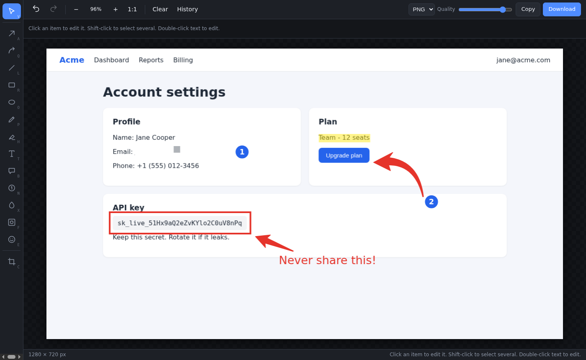
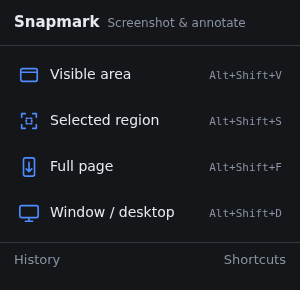

<div align="center">


# Snapmark

**Capture any page or window, then mark it up with arrows, highlights, blur and more.**
Free, open source, and 100% local: nothing ever leaves your browser.

[](https://github.com/jay2u/snapmark/actions/workflows/ci.yml)
[](LICENSE)
[](CHANGELOG.md)
[](https://chromewebstore.google.com/search/snapmark)
[](https://developer.chrome.com/docs/extensions/mv3/intro/)
[](tsconfig.json)
[](https://vite.dev)
[](PRIVACY.md)



</div>

## Features

### Capture
| | |
|---|---|
| **Visible area** | What you see right now. |
| **Selected region** | Drag a box over any part of the page. |
| **Full page** | Scrolls and stitches the whole page into one image. Sticky headers appear once; apps that scroll inside a panel work too. |
| **Window / desktop** | Any application window, a whole screen, or a tab, via Chrome's screen picker. |

### Annotate
- **Tapered brush arrows**, straight or curved, that grow bolder the longer you draw them
- Lines, rectangles (optionally rounded or filled), ellipses
- Pen and **highlighter**
- **Text** and speech-bubble **callouts**
- Auto-numbered **steps** (1, 2, 3…)
- **Blur / pixelate** to hide sensitive information
- **Spotlight** to dim everything except what matters
- Emoji **stamps** (✔️ ❌ ⚠️ ❓ …)
- **Crop**

Everything stays editable after you place it: move, resize, rotate, recolour, change size, opacity, fill or shadow;
drag arrow ends and bends; duplicate, reorder, delete. Full **undo / redo**, zoom and pan.

### Save & share
- **Download** as PNG or JPG (with a quality slider)
- **Copy** to the clipboard and paste straight into Slack, email or docs
- **History**: every capture is saved locally with its annotations, so you can reopen and keep editing

<div align="center">

</div>

## Install

### From the Chrome Web Store

Install Snapmark from the [Chrome Web Store](https://chromewebstore.google.com/search/snapmark) and pin it to the toolbar (puzzle-piece icon → pin).

### From source

To build it yourself or try the latest changes:

```bash
git clone https://github.com/jay2u/snapmark.git
cd snapmark
npm install
npm run build
```

1. Open `chrome://extensions` and switch on **Developer mode**.
2. Click **Load unpacked** and choose the `dist/` folder.
3. Pin Snapmark to the toolbar (puzzle-piece icon → pin).

Requires Node.js 20.19 or newer to build.

## Using it

Click the toolbar icon, or use a shortcut or the right-click menu.

| Action | Shortcut |
|---|---|
| Capture visible area | `Alt+Shift+V` |
| Capture selected region | `Alt+Shift+S` |
| Capture full page | `Alt+Shift+F` |
| Capture window / desktop | `Alt+Shift+D` |

Change these at `chrome://extensions/shortcuts`.

### Editor shortcuts

| Tool | Key | | Tool | Key |
|---|---|---|---|---|
| Select / move | `V` | | Text | `T` |
| Arrow | `A` | | Callout | `B` |
| Curved arrow | `Q` | | Numbered step | `N` |
| Line | `L` | | Blur / pixelate | `X` |
| Rectangle | `R` | | Spotlight | `F` |
| Ellipse | `O` | | Emoji stamp | `E` |
| Pen | `P` | | Crop | `C` |
| Highlighter | `H` | | | |

| Other | Key |
|---|---|
| Undo / redo | `Ctrl+Z` / `Ctrl+Shift+Z` (or `Ctrl+Y`) |
| Duplicate | `Ctrl+D` |
| Download / copy image | `Ctrl+S` / `Ctrl+C` |
| Delete selection | `Delete` |
| Nudge selection | Arrow keys (`Shift` = 10 px) |
| Zoom | `Ctrl+Wheel`, `Ctrl +`, `Ctrl -`, `Ctrl 0` to fit |
| Pan | Hold `Space` and drag |
| Straight / 45° angles, squares & circles | Hold `Shift` while drawing |
| Edit text | Double-click it (`Enter` to finish, `Shift+Enter` for a new line) |

## Privacy

Snapmark has **no servers, no accounts, no analytics and makes no network requests**. Screenshots and
annotations are stored only in your browser and can be deleted from the History page. See the
[privacy policy](PRIVACY.md).

## Permissions

| Permission | Why it is needed |
|---|---|
| `activeTab`, host access (`<all_urls>`) | Take a screenshot of the tab you choose, and scroll it for full-page capture. Nothing is read until you start a capture. |
| `scripting` | Inject the region selector and the scroller into the page you are capturing. |
| `storage`, `unlimitedStorage` | Save settings, and keep your capture history locally (screenshots can be large). |
| `contextMenus` | The right-click "Snapmark" menu. |
| `clipboardWrite` | Copy the finished image to the clipboard. |

## Known limits

- Chrome pages (`chrome://…`), the New Tab page, the Web Store and PDFs can't be scripted by extensions. Full page falls back to the visible area there.
- Local `file://` pages need **Allow access to file URLs** enabled in the extension's details.
- Full-page capture follows the largest scrolling area. Pages with several independent scrolling panels capture only the largest one.
- Capture stops at 30,000 px of page height, and very large images are scaled down to fit the browser's canvas limit.
- Chrome allows roughly two captures per second, so long pages take a few seconds. Progress shows on the toolbar icon; a red **!** means it failed, and the popup says why.
- Not included: video recording, cloud upload, PDF export.

## Development

```bash
npm install
npm run build        # production build to dist/
npm run dev          # rebuild on change (reload the extension after each build)
npm run typecheck    # strict TypeScript
npm test             # unit tests (Vitest)
```

### Project structure

```
manifest.config.ts       Manifest V3 definition (emitted into dist/ by the Vite config)
scripts/make-icons.mjs   Generates the toolbar icons — no image tools needed
src/
  background/            Service worker: capture orchestration, shortcuts, context menu
  content/               Scripts injected into pages: region selector, full-page scroller
  popup/                 Toolbar popup
  desktop/               Window / screen capture page (getDisplayMedia)
  editor/                Konva-based annotation editor (tools, nodes, serialization, UI)
  history/               Saved captures page
  shared/                IndexedDB layer, image stitching, messages, error messages
tests/                   Unit tests for the logic that doesn't need a browser
```

## Contributing

Contributions are welcome — see [CONTRIBUTING.md](CONTRIBUTING.md), or [open an issue](https://github.com/jay2u/snapmark/issues). Please read the
[changelog](CHANGELOG.md) for what changed between versions.

## License

[MIT](LICENSE) © 2026 JW
